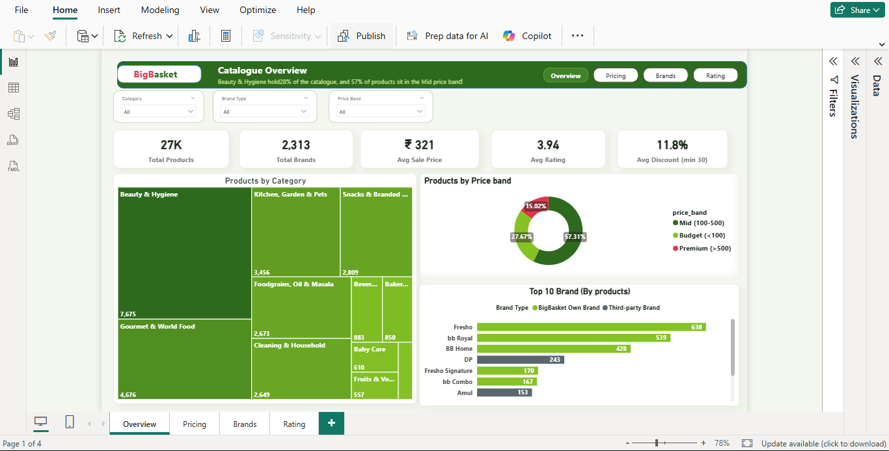
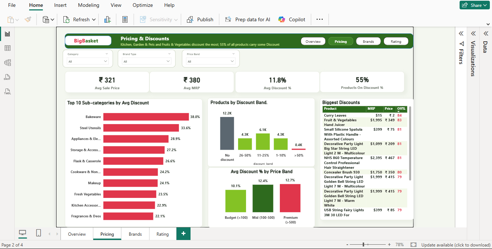
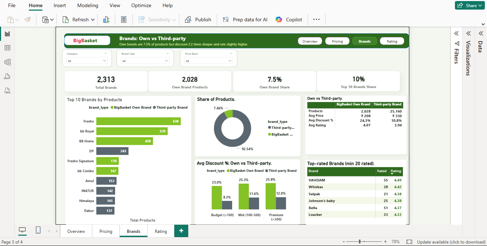
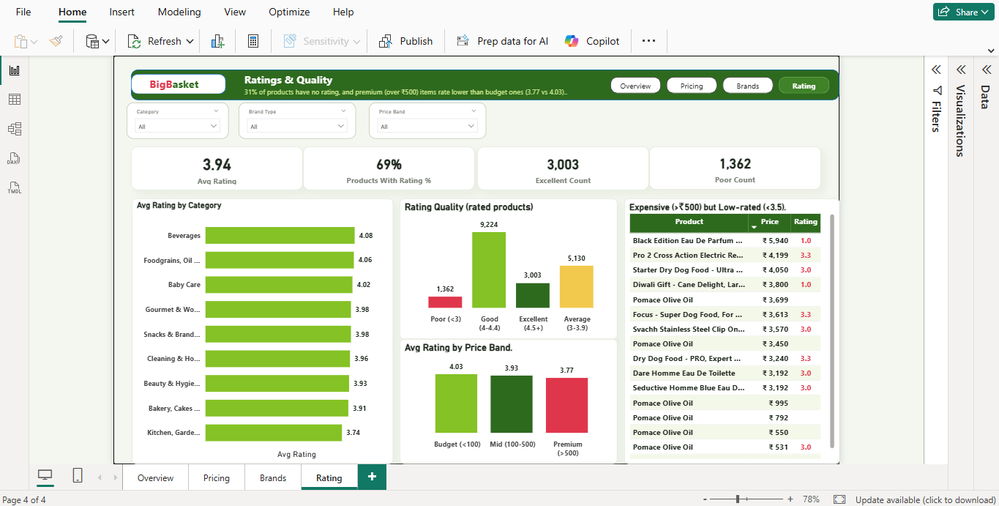

# BigBasket-Sales-Analysis
End-to-end BigBasket sales analysis using Python (data cleaning), MySQL (business queries) and Power BI (interactive dashboard).

# BigBasket Product Analysis

  <b>Catalogue, pricing, brands and ratings of 27,000+ products</b> 
  Python • MySQL • Power BI

  
  
  

<!-- NAVIGATOR -->

  <a href="#1-problem-statement">1. Problem</a> &nbsp;|&nbsp;
  <a href="#2-dataset-used">2. Dataset</a> &nbsp;|&nbsp;
  <a href="#3-key-questions-and-kpis">3. Questions and KPIs</a> &nbsp;|&nbsp;
  <a href="#4-process-and-methodology">4. Methodology</a> &nbsp;|&nbsp;
  <a href="#5-screenshots-and-insights">5. Screenshots and Insights</a> &nbsp;|&nbsp;
  <a href="#6-conclusion">6. Conclusion</a>

---

## At a Glance

| Products | Brands | Avg Sale Price | Avg Rating | Avg Discount |
|:---:|:---:|:---:|:---:|:---:|
| **27,188** | **2,313** | **₹321** | **3.94** | **11.8%** |

**Live dashboard:** [ADD YOUR POWER BI PUBLISH LINK HERE, or delete this line]

---

## 1. Problem Statement

BigBasket sells 27,000+ products across many categories, brands and price levels. It is not clear how the catalogue is spread across categories, how discounts are used, whether own brands behave differently from third-party brands, and where customer ratings are weak.

**Objective:** Analyse the product catalogue to understand assortment, pricing and discounts, brand mix and rating quality, and give simple, data-backed recommendations.

[Back to top](#bigbasket-product-analysis)

---

## 2. Dataset Used

| Item | Details |
|---|---|
| **Source** | [ADD DATASET NAME AND LINK, for example the Kaggle page] |
| **Size** | 27,188 products, [ADD number of columns] columns |
| **Download** | [Raw and cleaned data](data/) |
| **Note** | [ADD if the file is too large for GitHub: "Only a sample is uploaded, full data at the source link"] |

**Main fields used in the dashboard** (check against your dataset and edit):

| Field | Meaning |
|---|---|
| Product | Product name |
| Category / Sub-category | Product grouping |
| Brand | Brand name |
| Brand Type | BigBasket Own Brand or Third-party Brand |
| MRP | Maximum retail price |
| Sale Price | Price after discount |
| Discount % | Discount on MRP |
| Price Band | Budget (<100), Mid (100-500), Premium (>500) |
| Discount Band | No discount, 1-10%, 11-25%, 26-50%, >50% |
| Rating | Customer rating (blank for unrated products) |

**Project folders:** [`data/`](data/) | [`python/`](python/) | [`sql/`](sql/) | [`powerbi/`](powerbi/) | [`images/`](images/)

[Back to top](#bigbasket-product-analysis)

---

## 3. Key Questions and KPIs

**Key business questions**
1. How is the catalogue spread across categories and price bands?
2. Which categories and products carry the deepest discounts?
3. How do BigBasket own brands compare with third-party brands?
4. Where are ratings strong or weak, and how many products have no rating?

**KPIs tracked on each dashboard page**

| Page | KPIs |
|---|---|
| Overview | Total Products, Total Brands, Avg Sale Price, Avg Rating, Avg Discount |
| Pricing | Avg Sale Price, Avg MRP, Avg Discount %, Products On Discount % |
| Brands | Total Brands, Own Brand Products, Own Brand Share, Top 10 Brands Share |
| Rating | Avg Rating, Products With Rating %, Excellent Count, Poor Count |

[Back to top](#bigbasket-product-analysis)

---

## 4. Process and Methodology

Raw data → Python (clean) → MySQL (analyse) → Power BI (dashboard) → Insights

**Step 1: Data collection**
- Downloaded the product dataset from [ADD SOURCE].

**Step 2: Data cleaning (Python, Pandas)** - code in [`python/`](python/)
- [ADD what you did, for example: checked missing values and duplicates]
- [ADD what you did, for example: fixed data types and price columns]
- [ADD what you did, for example: created Price Band, Discount Band and Brand Type columns]
- Saved the cleaned file in [`data/`](data/).

**Step 3: Analysis (MySQL)** - queries in [`sql/`](sql/)
- [ADD, for example: products and average price by category]
- [ADD, for example: discount analysis by sub-category]
- [ADD, for example: own brand vs third-party comparison]
- [ADD, for example: top-rated brands with a minimum number of ratings]

**Step 4: Dashboard (Power BI)** - file in [`powerbi/`](powerbi/)
- Built a 4-page dashboard (Overview, Pricing, Brands, Rating) with a page navigator.
- Added filters for Category, Brand Type and Price Band on every page.
- Each page has KPI cards, charts and a headline that states the main finding.
- DAX measures: [ADD, for example: Total Products, Avg Discount %, Products On Discount %, Own Brand Share].

**Step 5: Insights**
- Read each page for patterns and wrote the findings and recommendations below.

[Back to top](#bigbasket-product-analysis)

---

## 5. Screenshots and Insights

**Dashboard navigator:**

  <a href="#overview-page">Overview</a> &nbsp;|&nbsp;
  <a href="#pricing-page">Pricing</a> &nbsp;|&nbsp;
  <a href="#brands-page">Brands</a> &nbsp;|&nbsp;
  <a href="#rating-page">Rating</a>

### Overview Page

**Insights**
- Beauty & Hygiene is the biggest category with 7,675 products (28% of the catalogue).
- 57% of products are in the Mid price band (₹100-500), 28% are Budget and 15% are Premium.
- Fresho (638), bb Royal (539) and BB Home (428) have the most products, and all three are own brands.

### Pricing Page

**Insights**
- Average MRP is ₹380 and average sale price is ₹321, with 55% of products on discount.
- Bakeware (38.0%), Steel Utensils (33.6%) and Appliances & Electricals (28.9%) have the highest average discount.
- Most discounted products sit in the 11-25% band (6.1K). Only about 0.4K have a discount above 50%.

### Brands Page

**Insights**
- Own brands are 7.5% of products (2,028 of 27,188) but offer a much deeper discount (24.3% vs 10.8%).
- Own brands are cheaper (₹208 vs ₹330 on average) and rate slightly higher (4.07 vs 3.94).
- Top-rated brands (minimum 20 rated products) are VADHAM (4.49), Whiskas (4.42) and Selpak (4.38).

### Rating Page

**Insights**
- 69% of products have a rating, so 31% have none.
- Of the rated products, 3,003 are excellent (4.5+) and 1,362 are poor (below 3).
- Premium products rate lowest (3.77) and Budget products rate highest (4.03).
- Beverages (4.08) is the best-rated category and Kitchen, Garden & Pets (3.74) is the lowest.

[Back to top](#bigbasket-product-analysis)

---

## 6. Conclusion

**What the analysis shows**
1. The catalogue is concentrated: Beauty & Hygiene is 28% of products and 57% are in the Mid price band.
2. Discounts are common but shallow: 55% of products have a discount, the average is 11.8%, and very deep discounts are rare.
3. Own brands win on value: only 7.5% of products, but cheaper, discounted about 2.2 times deeper, and rated higher than third-party brands.
4. Premium products have the weakest ratings (3.77 vs 4.03 for Budget).
5. 31% of products have no rating, which limits what can be said about quality for those items.

**Recommendations**
1. Review the premium assortment, since premium items rate lowest.
2. Ask customers for ratings, because 31% of products have none.
3. Test whether deep own-brand discounts are needed, since own brands already rate higher.
4. Look closely at Kitchen, Garden & Pets, which has the lowest average rating and one of the deepest discounts.

**Limitations**
- The dataset is a catalogue snapshot with no orders, sales volume or dates, so this is a catalogue and pricing analysis, not a sales analysis.
- Rating insights apply only to the 69% of products that have a rating.

---

## Author

**Pratham Gaikwad** | Aspiring Data Analyst

- Email: prathamgaikwad735@gmail.com
- LinkedIn: [pratham-gaikwad26](https://www.linkedin.com/in/pratham-gaikwad26)
- GitHub: [prathamgaikwad735-png](https://github.com/prathamgaikwad735-png)

[Back to top](#bigbasket-product-analysis)
